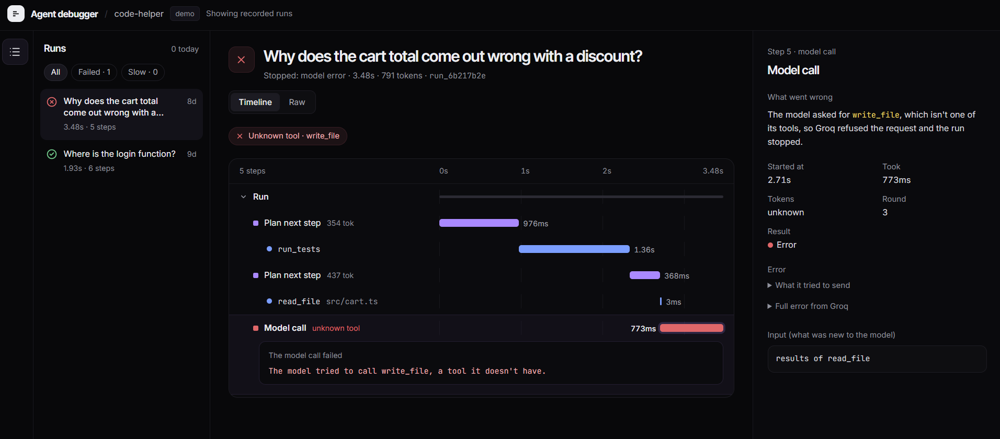

# Agent debugger

Like the Network tab in browser DevTools, but for an AI agent.

**Live demo:** https://agent-debugger-rho.vercel.app

The demo shows runs that were recorded earlier. You can browse them, but you can't start new ones.



## What it does

- Records every step of an agent run: each model call, each tool call, and the answer.
- Shows the run as a waterfall timeline, so you can see what happened, in what order, and how long each step took.
- Flags problems and points at the step where they happened:
  - a tool call failed
  - the model called a tool it doesn't have
  - the run hit the round limit without answering
  - the same tool was called twice with the same arguments
  - one step took most of the run's time

## How it works

1. The agent runs on my computer. It is a small coding agent that answers questions about a sample project.
2. The recorder saves each step as it happens. Keys are removed and long text is trimmed before anything is stored.
3. When the run ends, it is sent to the API, which stores it in Postgres. Saving needs a secret token; reading is open.
4. The website reads the run from the database and shows the timeline, the step details and the flags.

## A real example

The demo includes a run that asked: "Why does the cart total come out wrong with a discount?"

The agent ran the tests, read `src/cart.ts`, and found the bug. Then it tried to fix it with a `write_file` tool. It has no such tool: it can only list files, read files, search code and run tests. The model provider rejected the request and the run stopped after 3.5 seconds with no answer.

The debugger flags that step as "Unknown tool · write_file" and shows what the model tried to send.

## Tech stack

- Next.js 16 and React 19
- TypeScript
- Tailwind CSS 4
- Postgres on Neon, with Prisma 7
- Groq for the model (`openai/gpt-oss-120b`), used only by the agent on my computer
- Zod for checking incoming runs
- Vitest for tests
- Vercel for the demo

## Run it locally

You need Node 22, a Neon database and a Groq key.

```bash
npm install
cp .env.example .env.local    # then fill it in
npx prisma migrate deploy     # creates the tables
npm run dev                   # http://localhost:3000
```

In a second terminal:

```bash
npm run agent -- "Where is the login function?"
```

The run appears in the list on the left. `npm test` runs the tests and needs no key.

## Limits

- It records my own test agent only. There is no way yet to plug in another agent.
- No replay, run comparison or saved tests yet. Ideas for later.
- No accounts. One token decides who can save runs.
- The flags are simple rules. They catch the five problems above and nothing else.

Built by Felicia Udosen · [GitHub](https://github.com/Liciacodes) · [Portfolio](https://feliciaudosen.com)
